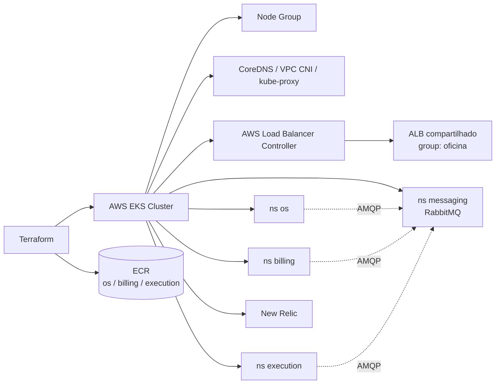

# TechChallengerFiap-K8s

## Propósito

Este repositório provisiona a infraestrutura Kubernetes do TechChallengerFiap na AWS: o cluster EKS, o node group, os addons, o AWS Load Balancer Controller, a observabilidade com New Relic e a infraestrutura compartilhada dos microsserviços (namespaces, RabbitMQ e repositórios ECR).

## Tecnologias utilizadas

- Terraform
- AWS EKS (Auto Mode + Managed Node Group)
- Kubernetes e Helm
- AWS IAM, OIDC e IRSA
- AWS Load Balancer Controller
- Amazon ECR
- RabbitMQ (imagem oficial, chart local)
- New Relic

## Arquitetura específica do repositório



### Infraestrutura compartilhada dos microsserviços

| Recurso | Arquivo | Detalhes |
|---|---|---|
| Namespaces `os`, `billing`, `execution`, `messaging` | `TFs/messaging.tf` | Um namespace por serviço |
| RabbitMQ | `TFs/messaging.tf` + `TFs/charts/rabbitmq` | 1 réplica, imagem oficial `rabbitmq:4.3-management`, PVC gp3 de 2Gi, requests de 256Mi |
| Secret `rabbitmq` (chave `RABBITMQ_URL`) | `TFs/messaging.tf` | Criado em cada namespace de serviço; os Deployments leem a URL dele |
| StorageClass `auto-ebs-gp3` | `TFs/messaging.tf` | EBS do EKS Auto Mode |
| ECR `os-service`, `billing-service`, `execution-service` | `TFs/ecr.tf` | Scan on push e retenção das últimas 15 imagens |

O RabbitMQ usa um chart próprio porque a Bitnami deixou de publicar as imagens gratuitas em 2025: `bitnami/rabbitmq` não tem mais tags públicas, e `bitnamilegacy` não recebe atualizações.

Endereço interno do broker: `rabbitmq.messaging.svc.cluster.local:5672` (AMQP) e `:15672` (painel de gestão, sem exposição externa). Para abrir o painel:

```bash
kubectl -n messaging port-forward svc/rabbitmq 15672:15672
# usuário: oficina | senha: terraform output -raw rabbitmq_url
```

### Roteamento (ALB compartilhado)

Cada serviço publica o próprio Ingress com `alb.ingress.kubernetes.io/group.name: oficina`. Assim, um único ALB atende todos:

| Path | Serviço | group.order |
|---|---|---|
| `/orcamentos`, `/pagamentos`, `/webhooks/mercadopago` | Billing | 10 |
| `/execucoes` | Execution | 10 |
| `/` (clientes, veículos, serviços, peças, OS, auth, docs) | OS Service | 100 |

## Passos para execução e deploy

### Pré-requisitos

- Terraform >= 1.6
- AWS CLI autenticado
- Permissões para criar EKS, IAM, ECR e Load Balancers
- kubectl e helm instalados

### Execução do provisionamento

```bash
cd TechChallengerFiap-K8s/TFs
terraform init
terraform validate
terraform plan
terraform apply
```

### Variáveis

| Variável | Padrão | Descrição |
|---|---|---|
| `newrelic_license_key` | – | License key do New Relic (sensível) |
| `node_instance_types` | `["t3.medium"]` | O t3.small comporta só 11 pods por nó, pouco para 3 serviços, RabbitMQ e New Relic |
| `rabbitmq_persistence` | `true` | `false` troca o PVC por emptyDir |
| `ecr_images_to_keep` | `15` | Retenção de imagens no ECR |

### Verificação do cluster

```bash
aws eks update-kubeconfig --name techchallenge-dev --region us-east-2
kubectl get nodes
kubectl get pods -n messaging
kubectl get secret rabbitmq -n os
terraform output ecr_repository_urls
```

## Estrutura principal

```text
TechChallengerFiap-K8s/
├── TFs/
│   ├── charts/rabbitmq/      chart local do RabbitMQ
│   ├── iam/
│   │   └── aws-load-balancer-controller-policy.json
│   ├── data.tf
│   ├── ecr.tf
│   ├── messaging.tf
│   ├── outputs.tf
│   ├── provider.tf
│   ├── resources.tf
│   └── variables.tf
├── README.md
└── ...
```

## Link para Swagger / Postman

A documentação da API fica no repositório de cada serviço. O Swagger do OS Service fica em `/api-docs`.

## Observações

- Valores sensíveis como `newrelic_license_key` ficam fora do controle de versão (`terraform.tfvars` está no `.gitignore`).
- A senha do RabbitMQ é gerada pelo Terraform (`random_password`) e fica só no state remoto e nos Secrets do cluster.
- Os volumes EBS do Auto Mode só montam em nós Auto Mode. Por isso, com persistência ligada, o RabbitMQ usa `nodeSelector eks.amazonaws.com/compute-type: auto`.
